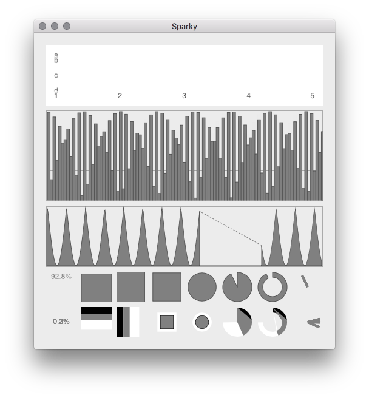

# SparkKit

Small, Simple and Fast; Line, Pie, Dial, Bar, Ring, Stack and Grid Views for macOS, iOS and tvOS

## Support SparkKit!

Are you using SparkKit in your apps? Would you like to help support the project and get a sponsor credit?

Visit our [Patreon Page](https://www.patreon.com/istumblerlabs) and patronize us in exchange for great rewards!

## Dependencies

### KitBridge

<a href="https://github.com/alfwatt/KitBridge">KitBridge</a> provides bridging for UIKit and AppKit.

## Using SparkKit

SparkKit is written in Swift and builds as a framework from `SparkKit.xcodeproj` or as a Swift package:

    .package(url: "https://github.com/alfwatt/SparkKit.git", branch: "main")

Then `import SparkKit` in Swift or `@import SparkKit;` in Objective-C.
The classes keep their `IL` names in the Objective-C runtime, so nibs and storyboards can use them as custom classes.

Style hints are dictionary keys, e.g. `ILSparkMeterStyleHint`, `ILSparkStackColorsHint` and `ILSparkLineScaleFactor`, defined as Swift constants.

`ILSparkFillDirectionHint` sets the direction every view fills in, an `ILSparkFillDirection`: `.fromTop`, `.fromBottom`, `.fromLeft` or
`.fromRight`, and for the square and circle meters and stacks `.inward` from the edges or `.outward` from the center.
Meters and stacks fill from that edge, bars grow from it, and the newest sample of a line or row of a grid is at it.
Without the hint each view keeps its own default.

## Classes

### ILSparkStyle

Style definitions which can be re-used across multiple views. Provides a default style.

### ILSparkView

Base class which manages borders and style information.

### ILSparkLine

Time-sequence line graph

### ILSparkMeter

Multiple style gauge indicators: text, vertical, horizontal, square, circle, ring, pie and dial

### ILSparkStack

A meter with a stack of values, in the same styles as ILSparkMeter

### ILSparkBars &amp; ILBucketData

Bar chart of bucketed values, e.g. a histogram

### ILSparkGrid &amp; ILGridData

High performance grid data view and source. The cells are square unless `ILSparkGridRowSizeHint` sizes the rows (0 stretches them to fill),
the newest row enters from the top or the edge `ILSparkFillDirectionHint` names, and `ILSparkGridEmptyColorHint` colors the grid where there's no data

## TODO

### ILSparkStream &amp; ILStreamData

Streaming data view and source

## Examples

See the included Sparky! application for usage example.

## Releases

- 0.1-beta      2018ish?
- 0.2-beta      2024ish? (TODO)

## License

    The MIT License (MIT)

    Copyright © 2016-2024 Alf Watt

    Permission is hereby granted, free of charge, to any person obtaining a copy
    of this software and associated documentation files (the "Software"), to deal
    in the Software without restriction, including without limitation the rights
    to use, copy, modify, merge, publish, distribute, sublicense, and/or sell
    copies of the Software, and to permit persons to whom the Software is
    furnished to do so, subject to the following conditions:

    The above copyright notice and this permission notice shall be included in all
    copies or substantial portions of the Software.

    THE SOFTWARE IS PROVIDED "AS IS", WITHOUT WARRANTY OF ANY KIND, EXPRESS OR
    IMPLIED, INCLUDING BUT NOT LIMITED TO THE WARRANTIES OF MERCHANTABILITY,
    FITNESS FOR A PARTICULAR PURPOSE AND NONINFRINGEMENT. IN NO EVENT SHALL THE
    AUTHORS OR COPYRIGHT HOLDERS BE LIABLE FOR ANY CLAIM, DAMAGES OR OTHER
    LIABILITY, WHETHER IN AN ACTION OF CONTRACT, TORT OR OTHERWISE, ARISING FROM,
    OUT OF OR IN CONNECTION WITH THE SOFTWARE OR THE USE OR OTHER DEALINGS IN THE
    SOFTWARE.
